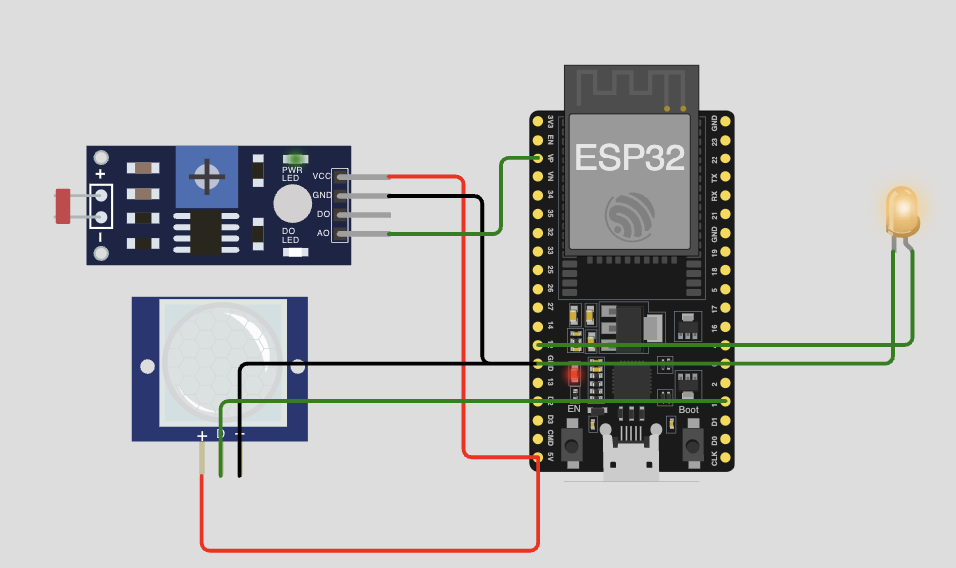
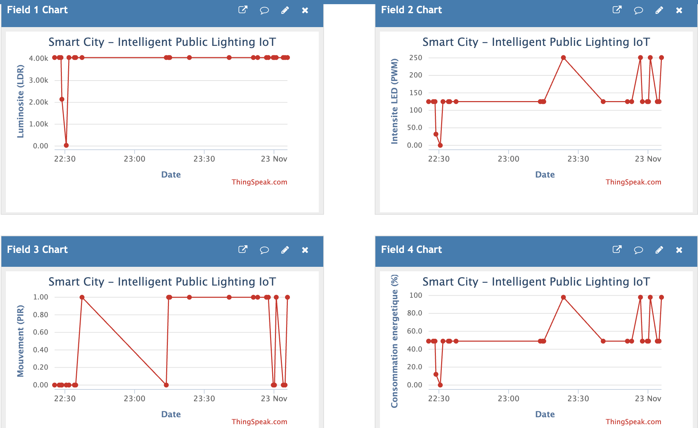
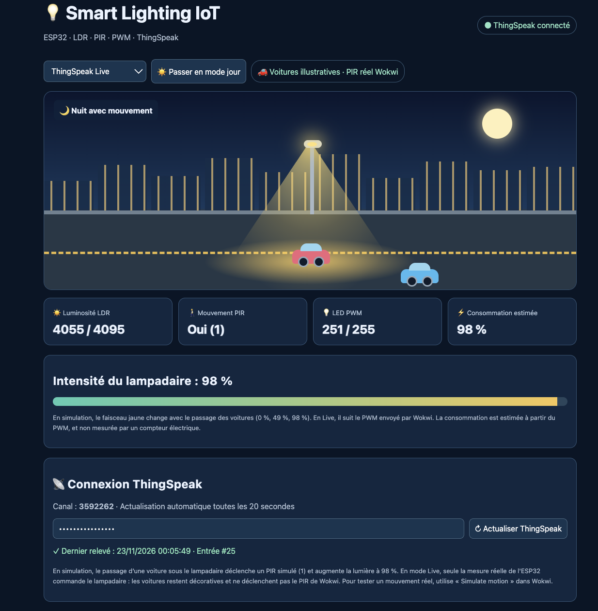

# 💡 Smart Lighting IoT — Éclairage public intelligent

## 📌 Description

Ce projet simule un système d'éclairage public intelligent utilisant un ESP32, un capteur de luminosité LDR et un capteur de mouvement PIR.

L'objectif est d'adapter automatiquement l'intensité lumineuse en fonction de la luminosité ambiante et de la présence de mouvement afin de réduire la consommation énergétique.

## 🛠️ Technologies utilisées

- **ESP32** : microcontrôleur
- **LDR** : détection de la luminosité ambiante
- **PIR** : détection de mouvement
- **LED PWM** : réglage de l'intensité lumineuse
- **Wokwi** : simulation électronique
- **ThingSpeak** : collecte et visualisation des données IoT
- **HTML, CSS et JavaScript** : dashboard interactif

## ⚙️ Fonctionnement

| Situation | Intensité lumineuse |
|---|---|
| Jour | 0 % |
| Nuit sans mouvement | Environ 49 % |
| Nuit avec mouvement | Environ 98 % |

Les mesures sont envoyées vers ThingSpeak environ toutes les 20 secondes.

## 🚗 Dashboard interactif

Le dashboard propose deux modes :

**Simulation autonome :** les voitures animées déclenchent une détection simulée lorsqu'elles passent sous le lampadaire.

**ThingSpeak Live :** le dashboard récupère les données de l'ESP32 via ThingSpeak. Les voitures restent illustratives.

## 📊 Données ThingSpeak

Canal : **3592262**

- Field 1 : luminosité LDR
- Field 2 : intensité LED PWM
- Field 3 : mouvement PIR
- Field 4 : consommation énergétique estimée

## 🚀 Utilisation

1. Ouvrir le projet ESP32 dans Wokwi.
2. Lancer la simulation.
3. Ouvrir `index.html` dans un navigateur.
4. Choisir le mode Simulation autonome ou ThingSpeak Live.
5. Pour le mode Live, saisir la Read API Key du canal ThingSpeak.

## 🎯 Objectif

Démontrer comment l'IoT permet d'automatiser l'éclairage public et d'adapter la consommation énergétique aux conditions environnementales.

## 📸 Captures d'écran

### 1. Simulation du circuit ESP32 — Wokwi

### 2. Visualisation des données — ThingSpeak

### 3. Dashboard Smart Lighting IoT

